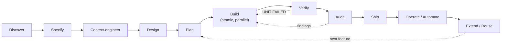

# Agentic Engineering Playbook

A single source of truth for building software **by directing Claude** — from first discovery call to production and beyond.

It is three things at once:

| | What you get | Where |
|---|---|---|
| **Learning path** | One end-to-end, lifecycle-ordered guide to agentic engineering with Claude.ai Projects, Claude Design, Claude Code (CLI + Desktop) and mobile Remote Control | [`docs/`](docs/) |
| **Reference** | Copy-paste prompts, commands, checklists and fill-in-the-blank planning documents | [`prompts/`](prompts/), [`templates/`](templates/), [`CHEATSHEET.md`](CHEATSHEET.md) |
| **Drop-in kit** | A least-privilege `.claude/` config, verification skills, reviewer subagents, fast hooks, a personal plugin, and bootstrap scripts for new **and** existing repos | [`kit/`](kit/), [`plugin/`](plugin/), [`scripts/`](scripts/) |

> **New to all of this?** Start with the [Beginner's guide](docs/BEGINNERS-GUIDE.md) — install, first safe session, and a small project built step by step.

> **Director, not typist.** You direct the system that builds; planning documents are the source of truth; every unit ships atomically and is verified mechanically.

---

## The lifecycle

Every page in `docs/` maps to one stage of this flow. Planning happens twice: a first `BUILD_SEQUENCE.md` is drafted with the contract ([02](docs/02-discover-and-plan.md)); **Plan** is where it's refined per feature once context and design exist (`/plan-feature`).



| Stage | Read | Use |
|---|---|---|
| Mental model (start here) | [`docs/00-mental-model.md`](docs/00-mental-model.md) | The Three Standards, surfaces map |
| Setup | [`docs/01-setup.md`](docs/01-setup.md) | Install, auth, safety baseline |
| Discover → Specify → Plan | [`docs/02-discover-and-plan.md`](docs/02-discover-and-plan.md) | PRD, Contract, Build Sequence templates |
| Context-engineer | [`docs/03-context-engineering.md`](docs/03-context-engineering.md) | `CLAUDE.md`, context files, skills vs rules |
| Design | [`docs/04-design.md`](docs/04-design.md) | Behavioural spec, `DESIGN.md`, Claude Design |
| Build | [`docs/05-build.md`](docs/05-build.md) | Atomic units, worktrees, parallel sessions |
| Verify + Audit | [`docs/06-verify.md`](docs/06-verify.md) | `/verify-unit`, reviewer subagents, Director's Audit |
| Ship | [`docs/09-ship-and-operate.md`](docs/09-ship-and-operate.md) | Secrets, deploy, production verification |
| Operate / Automate | [`docs/07-automate.md`](docs/07-automate.md) | Permissions, `/goal`, routines, GitHub Actions |
| Extend / Reuse | [`docs/08-extend.md`](docs/08-extend.md) | Skills, subagents, hooks, plugins, MCP |
| Existing repo | [`docs/10-brownfield-adoption.md`](docs/10-brownfield-adoption.md) | `scripts/adopt-existing.sh` |
| New project | [`docs/11-greenfield-kickoff.md`](docs/11-greenfield-kickoff.md) | `scripts/bootstrap-new.sh` |
| Client work | [`docs/12-fde-playbook.md`](docs/12-fde-playbook.md) | Discovery → pilot → rollout → handover |
| When it goes wrong | [`docs/13-troubleshooting.md`](docs/13-troubleshooting.md) | Symptom → cause → fix |


---

## 5-minute quickstart

**Prerequisites:** Claude Code installed and signed in (`claude --version`), git, Node 22+ for the worked example.

**A. Apply the kit to an existing repo (brownfield)**

```bash
git clone https://github.com/deeprajsshetty/agentic-engineering-playbook ~/agentic-engineering-playbook
cd ~/code/your-repo && git switch -c chore/adopt-agentic-kit
~/agentic-engineering-playbook/scripts/adopt-existing.sh --dry-run .
~/agentic-engineering-playbook/scripts/adopt-existing.sh .
```

Then in Claude Code: `/init`, then `/onboard-repo`. Full walkthrough: `docs/10-brownfield-adoption.md`.

**B. Start a new project (greenfield)**

```bash
~/agentic-engineering-playbook/scripts/bootstrap-new.sh ~/code/my-new-app
```

Full walkthrough: `docs/11-greenfield-kickoff.md`.

**C. Install the personal plugin everywhere**

```text
/plugin marketplace add deeprajsshetty/agentic-engineering-playbook
/plugin install my-standards@deeprajsshetty-standards
/reload-plugins
```

---

## The Three Standards

Ask these of every plan, every diff, every release:

1. **Does it scale?** Could another agent continue from the documents and current state?
2. **Is it secure?** No secrets in source or prompts, no unapproved dependencies or data flows.
3. **Do I know exactly why it works?** Can you trace each decision to a requirement and point to where the next change belongs?

---

## Conventions used in this repo

- `⚠️ Verify: course-described, not confirmed in current docs` — a feature taught in the course that could not be confirmed against the official Claude Code docs at the time of writing. Check before relying on it.
- Every command, flag, settings key and hook event was checked against [the Claude Code docs](https://code.claude.com/docs/en/overview) in October 2026. Features move fast; when in doubt, the docs win.
- Every copy-paste prompt is in a fenced block. Replace `[bracketed]` placeholders with your own project's details.

## Credits

The method in this playbook — the director's workflow, the Three Standards, the planning-document set, atomic shipping and the Director's Audit — comes from the **Claude Code Bootcamp** by **Jacinto Design**. Course reference material: [JacintoDesign/claude-code-bootcamp-reference](https://github.com/JacintoDesign/claude-code-bootcamp-reference). This repo reorganises, condenses and extends that material into a lifecycle playbook and reusable kit; it is not a copy of the course. See [`sources/`](sources/) for the full attribution and a module-to-page map.

## Licence

[MIT](LICENSE) for the original content and code in this repository. Course material remains the property of its author.
