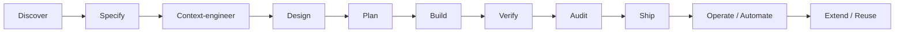

# Docs index

Every page follows the same eight parts: **Goal · Which surface · Inputs → Outputs · Steps · Verified when… · Three Standards check · Common mistakes · Course reference.**

| Stage | Page | Templates | Prompts | Kit |
|---|---|---|---|---|
| (new here?) | [Beginner's guide](BEGINNERS-GUIDE.md) — step by step from install to a verified project | all | all | all |
| (start here) | [00 — Mental model](00-mental-model.md) | — | — | — |
| Setup | [01 — Setup and safety baseline](01-setup.md) | — | — | `kit/.claude/settings.json` |
| Discover → Specify → Plan | [02 — Discover, specify, plan](02-discover-and-plan.md) | PRD, CONTENT_MODEL, CONTRACT, BUILD_SEQUENCE | [plan](../prompts/plan/README.md) | `/plan-feature` |
| Context-engineer | [03 — Context engineering](03-context-engineering.md) | CLAUDE.md.template | — | `context/`, `rules/` |
| Design | [04 — Design](04-design.md) | DESIGN_SPEC, DESIGN_STANDARD, MOTION_BRIEF | [design](../prompts/design/README.md) | `visual-auditor`, `a11y-auditor` |
| Build | [05 — Build](05-build.md) | BUILD_SEQUENCE | [build](../prompts/build/README.md), [refactor](../prompts/refactor/README.md) | `/verify-unit`, `/ship-unit` |
| Verify + Audit | [06 — Verify and audit](06-verify.md) | AUDIT_LOG | [verify](../prompts/verify/README.md), [audit](../prompts/audit/README.md) | `/verify-app`, `/audit`, reviewer subagents, hooks |
| Ship | [09 — Ship and operate](09-ship-and-operate.md) | CONTRIBUTING | [deploy](../prompts/deploy/README.md) | `/handoff` |
| Operate / Automate | [07 — Automate safely](07-automate.md) | — | [refactor](../prompts/refactor/README.md), [deploy](../prompts/deploy/README.md) | `claude-review.yml` |
| Extend / Reuse | [08 — Extend and reuse](08-extend.md) | — | — | `plugin/my-standards` |
| Existing repo | [10 — Brownfield adoption](10-brownfield-adoption.md) | — | — | `scripts/adopt-existing.sh` |
| New project | [11 — Greenfield kickoff](11-greenfield-kickoff.md) | all | — | `scripts/bootstrap-new.sh` |
| Client work | [12 — FDE playbook](12-fde-playbook.md) | ADR | — | — |
| Problems | [13 — Troubleshooting](13-troubleshooting.md) | — | [correction patterns](../prompts/correction-patterns.md) | — |

Templates live in [`templates/`](../templates/); the kit in [`kit/`](../kit/).
